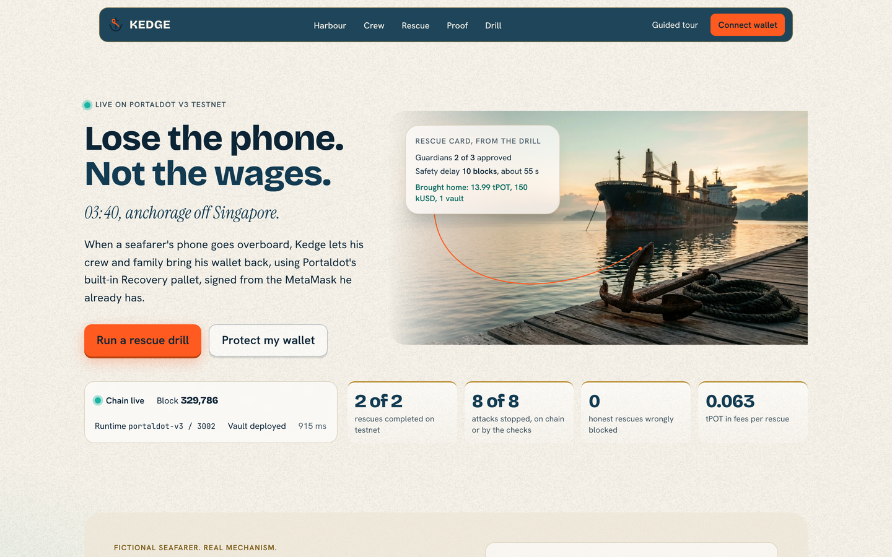
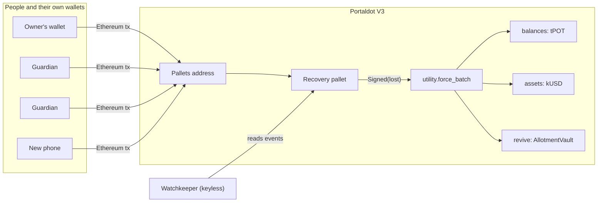
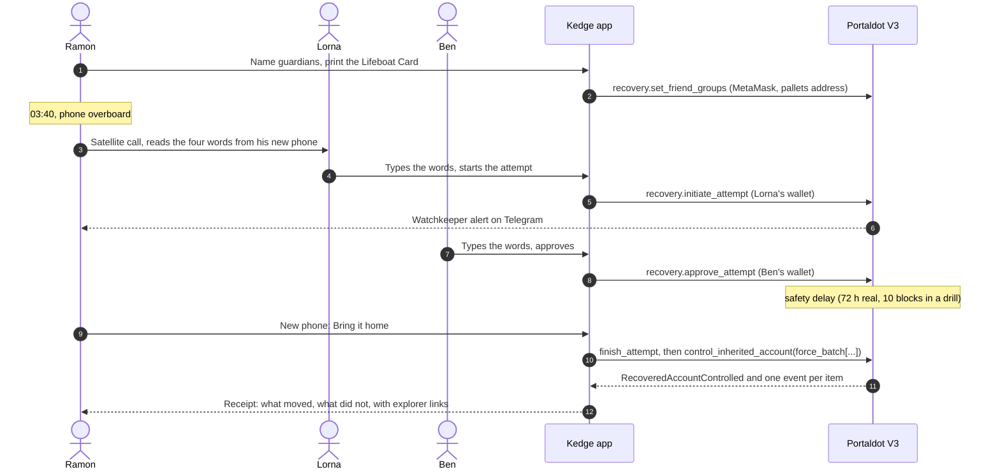

<h1 align="center">Kedge</h1>

<p align="center">
  <a href="https://kedge-kinnoskis-projects.vercel.app"></a>
  <a href="https://github.com/0xkinno/kedge/actions/workflows/ci.yml"></a>
  
</p>

> When a seafarer's phone goes overboard, Kedge lets his crew and family bring his wallet back, using Portaldot's built-in Recovery pallet, signed from the MetaMask he already has.

**A wallet your crew can bring back, and no single person can take.**



At 03:40 off Singapore, Ramon's phone slips over the side with his wages on it. His wife Lorna and his bosun Ben confirm on a call that it is really him, approve from their own wallets, and after a safety delay his new phone brings home his tPOT, his native asset and the savings his allotment contract holds, with one signature. All of it runs on the Portaldot V3 testnet today, and every number below comes from receipts you can re-read yourself.

| | |
|---|---|
| **Live app** | https://kedge-kinnoskis-projects.vercel.app (no login) |
| **For judges** | [`/judge`](https://kedge-kinnoskis-projects.vercel.app/judge): a 60-second, 3-minute and 10-minute walk |
| **Run a rescue** | [`/drill`](https://kedge-kinnoskis-projects.vercel.app/drill): a full rescue on the live testnet in about two minutes |
| **Verify it yourself** | [`/proof`](https://kedge-kinnoskis-projects.vercel.app/proof) decodes every recorded transaction in your browser; `npm run verify` re-reads 31 of them from the public node with no key |
| **Demo video** | link added at upload (2 min 50 s) |
| **Pitch deck** | [docs/kedge-deck.pdf](docs/kedge-deck.pdf) |
| **Kedge Kit** | [packages/kedge-kit](packages/kedge-kit): add recovery to your own Portaldot dApp (in this repository; not published to npm) |
| **Track** | Ecosystem DApps |
| **Built on** | Portaldot V3: Recovery, Utility, Assets with the ERC-20 precompile, Revive, the pallets address |
| **Measured** | 16 of 16 scenarios as expected; 2 of 2 rescues completed; 8 of 8 attacks stopped; **0** honest rescues wrongly blocked; 0.063 tPOT in fees per rescue |

<table>
<tr><td width="50%"><br /><sub><b>Harbour.</b> The owner names a crew, makes a passphrase-locked key for a new phone, and sees the cost before signing.</sub></td>
<td width="50%"><br /><sub><b>Crew door.</b> A guardian hears four words on a call and types them. Approve stays locked until they match.</sub></td></tr>
<tr><td><br /><sub><b>Rescue.</b> Timeline, delay clock in blocks, and a dry run of every item: will move, or will not move and why.</sub></td>
<td><br /><sub><b>Proof.</b> Every recorded transaction, decoded in your browser from the public node.</sub></td></tr>
</table>

## The problem

Ramon Dizon, 34, is an able seaman from Iloilo, seven months into a nine-month contract on a bulk carrier. His wages and savings sit in a wallet on his phone. His seed phrase is on a scrap of paper in a drawer at home, or nowhere. Tonight, during a mooring operation, the phone slips out of his coverall pocket and goes over the side. Port wifi is nine days away; his next allotment to Lorna is due in twelve. A seed-phrase wallet has no "forgot password", custodial apps want identity checks from a ship with no signal, and a company-run seed backup means handing his keys to a company. (Ramon, Lorna, Ben and Ana are illustrative characters; the mechanism and every transaction are real.)

| What is true | Source |
|---|---|
| About 1.89 million seafarers serve the world merchant fleet. | [World shipping faces looming officer shortage](https://www.marinelog.com/news/world-shipping-faces-looming-officer-shortage/), 2021-07-28 |
| Sea-based Filipino workers sent home 7.139 billion US dollars in 2025. | [OFW remittances hit record $35.6B](https://bworldonline.com/top-stories/2026/02/17/730931/ofw-remittances-hit-record-35-6b/), 2026-02-17 |
| About 3.7 million bitcoin, around 20 percent of supply, had not moved for at least five years in June 2020. Dormancy is a proxy for lost, not proof of lost keys. | [Lost Bitcoin: 3.7 million Bitcoin are probably gone forever](https://decrypt.co/37171/lost-bitcoin-3-7-million-bitcoin-are-probably-gone-forever), 2020 (exact article date not shown in page text) |
| A hardware-wallet vendor's seed backup service split the phrase among three custodians and drew public backlash in 2023. | [So Much Anger, So Much Hate, Says Ledger Co-Founder Amid Botched Recover Service Launch](https://decrypt.co/140692/so-much-anger-so-much-hate-says-ledger-co-founder-amid-botched-recover-service-launch), 2023-05-19 |
| An exchange founder died and roughly 190 million Canadian dollars in customer crypto became inaccessible (2019). | [Customers Out $190M After Founder Dies, Cryptocurrency Exchange Says](https://www.vice.com/en/article/customers-out-dollar190m-after-founder-dies-cryptocurrency-exchange-says/), 2019-02-04 |
| The Philippines ranks 9th overall in the 2025 Chainalysis Global Crypto Adoption Index. | [The 2025 Global Adoption Index: India and the United States Lead Cryptocurrency Adoption](https://www.chainalysis.com/blog/2025-global-crypto-adoption-index/), 2025-09-02 |

Exact quotes, dates and caveats are in [docs/sources.json](docs/sources.json); `npm run verify:sources` re-checks them against the live pages.

## The solution

1. **Name the crew.** From MetaMask, Ramon picks guardians (Lorna, Ben, Ana), how many must agree, the safety delay, and the wallet on a new phone. It costs only a fee.
2. **Keep the Lifeboat Card.** A wallet-size PDF holds his new key, locked with a passphrase only he knows. Alone it cannot move a cent.
3. **Call, hear, type.** The guardians are the eyes and judgment. When Ramon calls from the ship, his new phone shows four words derived from (lost wallet, new wallet, group, chain). Lorna types them; **approve stays disabled until they match**. A scam link that names a different new wallet produces different words.
4. **Wait.** Two approvals start the delay. Ramon gets one alert per attempt, and while he still holds his phone he can stop it or slash the starter.
5. **Bring it home.** His new phone finishes the attempt and signs once. A single `force_batch` pays out the vault, moves the native asset, then sweeps the coin. If one item fails, the rest still move and the receipt shows exactly which.

**What always gets through:** an attempt Ramon did not start reaches him as an alert, and he can cancel it. A second family group, set once, can outrank the crew if he never comes home.

## Explore it in 2 minutes

1. Open [`/drill`](https://kedge-kinnoskis-projects.vercel.app/drill) and press **Start the drill**. House crew keys run a full rescue on the live testnet.
2. Watch the safety delay count down in blocks.
3. Read the receipt: each item has its own status and an explorer link.
4. Open [`/proof`](https://kedge-kinnoskis-projects.vercel.app/proof), filter to **A3**, press **Check**. Your browser reads the block from the public node and decodes `recovery.NotYetInheritable`, a rescue the chain refused for coming too early.
5. Click the explorer link on that row to see the same failed extrinsic on the block explorer.

## Architecture



```
 Ramon's MetaMask   Lorna     Ben     Ramon's new phone
        |             |        |             |
        v             v        v             v
   Ethereum tx to the Portaldot pallets address (0x6d6f...0000)
 set_friend_groups  initiate  approve   finish + control_inherited_account
        '-------------+--------+-------------'
                      v
              Recovery pallet (native)
                      | Signed(Ramon's old account)
                      v
            utility.force_batch([ ... ])
    +---------------+----------------+-------------------------+
    v               v                v
 balances: tPOT  assets: kUSD   revive.call: AllotmentVault
                                (msg.sender = Ramon's old 0x address)
```

| Module | One job | Can it sign? |
|---|---|---|
| Purser `purser.ts` | builds every call from live metadata | no |
| Helmsman `helm.ts` | sends the wallet transaction, persists the hash first, resolves the real outcome from events | the user's wallet only |
| Lookout `lookout.ts` | reads crews, attempts, delay clocks | no |
| Surveyor `survey.ts` | inventories the old wallet and dry-runs every sweep item | no |
| Mate `mate.ts` | pre-flight refusals (contract inheritor, sorting, thresholds, delay) | no |
| Watchkeeper `watch/` | detects attempts, alerts the owner | no, keyless by construction |
| Logkeeper `scripts/facts.mjs` | writes the numbers on this page from receipts | no |

No model sits anywhere in the money path. All of the engine modules live in one place, the [Kedge Kit](packages/kedge-kit), and the app imports them from there.

## Product flow



## Why this needs Portaldot

Portaldot V3 is the hero of this build. Every MetaMask address has a native **twin account** (`h160` followed by twelve `0xEE` bytes, verified against the chain). An Ethereum transaction to the runtime **pallets address** is dispatched as a native call signed by that twin, so a plain MetaMask address can use the chain's **Recovery pallet** (the friend-group version, with priorities, delays and a cancel window). When the inheritor runs `revive.call` inside `control_inherited_account`, a Solidity contract sees the **old address** as `msg.sender`, so the vault pays out. Native assets are reached from Solidity through the **ERC-20 precompile**, and the whole sweep moves in one `utility.force_batch`. Measured in [PLATFORM_PROBE.md](PLATFORM_PROBE.md); the reasoning is in [DISCOVERY.md](DISCOVERY.md).

**Delete test:** remove Portaldot's Recovery pallet and step 5 fails, because there is no inheritor and no way to act as the lost account.

## Why this is different

| Approach | Who can move the money | What it costs the user | Weak point |
|---|---|---|---|
| Seed phrase on paper | anyone who finds it | nothing | lost paper means lost wallet; found paper means stolen wallet |
| Company-held seed backup | the company, a court order, a breach | a subscription and an identity check | custody by another name, and it needs a signal and a camera |
| Smart-contract wallet with guardians | guardians, through a contract | a new wallet and a migration | you must change wallets **before** the loss, and each chain needs its own |
| Exchange custody | the exchange | fees and KYC | one founder, one server: a single point of failure |
| **Kedge on Portaldot** | **two of your guardians, after a delay you set, and you can still cancel** | **0.027 tPOT to protect, 0.063 tPOT to rescue** | no new wallet; the Recovery pallet is the chain's own, and the rescue reaches money held in Solidity contracts |

A rescue that only moved native coins would leave a seafarer's savings stranded in contracts. Kedge's sweep also pays out a Solidity vault that only the old address could withdraw from, because the chain lets the rescuer call it **as** that address.

## Safety model

| Who | What they can try | What stops them | Proof |
|---|---|---|---|
| A stranger | start an attempt on your wallet | `NotFriend` | A1 |
| One guardian alone | finish with one approval | `NotApproved` | A2 |
| A guardian in a hurry | finish before the delay | `NotYetInheritable` | A3 |
| A guardian voting twice | stack approvals | `AlreadyApproved` | A4 |
| A bad initiator | cancel to dodge a slash | `NotYetCancelable` | A6 |
| A rescuer | rewrite the crew through the inheritance | the call is filtered: `call_result = Err` | A7 |
| A lower-priority group | take over after the family group recovered | `HigherPriorityRecovered` | A9 |
| A scam link | show a different new wallet | the four words differ, approve stays locked | A12 |
| A bad sweep item | block the rest | `force_batch`: that item fails, the others move | A10 |
| Nobody at all (no Kedge) | move a wallet whose key is gone | no path exists | C1, C2 |

The four-word phrase is **advisory UI**: it helps a human catch a scam. The chain enforces the approval count and the delay.

### What it will not do

| Refusal | Where | Backed by |
|---|---|---|
| Name a contract as the inheritor | `mate.ts` | probe part 8: a contract calling the pallets address does nothing |
| List guardians unsorted or twice | `mate.ts`, `purser.ts` | chain `FriendsNotSortedOrUnique`, even with our check disabled (`KEDGE_SABOTAGE=sort`) |
| Rescue before the delay | `mate.ts` | A3 |
| Approve without the phrase | Crew door | A12 (advisory) |
| Move an item that would fail | `survey.ts` | A10 |
| Run a drill when the kill switch is on or keys are missing | `/api/drill` | HTTP 503 with a plain message |

## Measured

Both directions are reported, **and the second number is the one that matters.** Money figures are rounded here; exact values are in `docs/FACTS.json`.

| | |
|---|---|
| All scenarios | 16 of 16 as expected: 2 on-chain happy paths (H1, H2), 6 on-chain refusals with a decoded error (A1, A2, A3, A4, A6, A9), 4 on-chain behaviours (A5, A7, A8, A10), 2 guard refusals (A11, A12), 2 counterfactuals (C1, C2) |
| Rescues completed / attempted (curated campaign) | 2 of 2 (one with a guardian on a native sr25519 wallet) |
| Attacks stopped | 8 of 8: 6 refused on chain and 2 stopped by pre-flight guards |
| Honest rescues wrongly blocked | 0 |
| Cost to protect | 0.027 tPOT fee, 0 deposit |
| Cost per rescue | 0.063 tPOT in fees |
| Contract storage deposit refunded in the sweep | 3.799 tPOT |
| Safety delay | 10 blocks, measured 55 s |
| Public drills | 3 completed on the public page; approval to home: min 68 s, median 68 s, max 68 s (1 timed); a second request during a run is refused (HTTP 409) |
| Unattended alert | a Telegram alert delivered by the GitHub Actions Watchkeeper (started by a manual dispatch of the workflow; screenshot in `docs/demo/telegram-alert.png`) |
| Real-people drill | in preparation (protocol in `docs/REAL_PEOPLE_DRILL.md`) |
| Browser end-to-end | 12 of 12 steps passed against the live site |

| Id | Scenario | Result | Observed | Proof |
|---|---|---|---|---|
| H1 | Happy path: setup, initiate, approve, wait, finish, bring home (tPOT + kUSD + vault) | as expected | `Ok` | [317396](https://scanner-testnet-v3.portaldot.dev/#/blocks/317396?tab=events) |
| H2 | Cross-VM guardians: one sr25519 guardian approves with a native extrinsic, two on MetaMask | as expected | `Ok` | [317418](https://scanner-testnet-v3.portaldot.dev/#/blocks/317418?tab=events) |
| A1 | A1 | as expected | `recovery.NotFriend` | [317445](https://scanner-testnet-v3.portaldot.dev/#/blocks/317445?tab=events) |
| A2 | A2 | as expected | `recovery.NotApproved` | [317447](https://scanner-testnet-v3.portaldot.dev/#/blocks/317447?tab=events) |
| A3 | A3 | as expected | `recovery.NotYetInheritable` | [317450](https://scanner-testnet-v3.portaldot.dev/#/blocks/317450?tab=events) |
| A4 | A4 | as expected | `recovery.AlreadyApproved` | [317449](https://scanner-testnet-v3.portaldot.dev/#/blocks/317449?tab=events) |
| A5 | A5 | as expected |  | [317451](https://scanner-testnet-v3.portaldot.dev/#/blocks/317451?tab=events) |
| A6 | A6 | as expected | `recovery.NotYetCancelable` | [317453](https://scanner-testnet-v3.portaldot.dev/#/blocks/317453?tab=events) |
| A7 | Reentrancy guard: inheritor tries to rewrite recovery config through control_inherited_account | as expected | `{"Err":{"Module":{"index":"0","error":"0x05000000"}}}` | [317482](https://scanner-testnet-v3.portaldot.dev/#/blocks/317482?tab=events) |
| A8 | Priority override: Family (priority 0) finishes after Crew | as expected |  | [317480](https://scanner-testnet-v3.portaldot.dev/#/blocks/317480?tab=events) |
| A9 | Priority lock: Crew tries again after Family recovered | as expected | `recovery.HigherPriorityRecovered` | [317481](https://scanner-testnet-v3.portaldot.dev/#/blocks/317481?tab=events) |
| A10 | Sweep with one item that must fail | as expected | `Ok` | [317483](https://scanner-testnet-v3.portaldot.dev/#/blocks/317483?tab=events) |
| A11 | Contract set as inheritor | as expected |  | guard |
| A12 | Scam link with a different inheritor | as expected |  | guard |
| C1 | Counterfactual: a wallet without Kedge, key discarded | as expected |  | guard |
| C2 | Counterfactual: EVM-only vault position without Kedge | as expected |  | [317489](https://scanner-testnet-v3.portaldot.dev/#/blocks/317489?tab=events) |

**Misses and surprises.** We predicted `AlreadyVoted` for a double approval; the chain says `AlreadyApproved` (A4), and the pass criterion was amended openly. Our first campaign run read refused calls as successes until we found the `EthExtrinsicRevert` shape. A5 removed the attempt but burned nothing. Each is in [docs/FINDINGS.md](docs/FINDINGS.md).

## Testnet deployment

| Contract | Address | Deploy tx | Block | Size | Cost |
|---|---|---|---|---|---|
| AllotmentVault (Solidity) | `0x92cD058Cb7E4d69476bFc7Cbb7630C50f13B57D4` | `0x5d20d9a0c4be0cda48c3602ca60e8246cf38f691c6f53373f87d982643118ce8` | [317284](https://scanner-testnet-v3.portaldot.dev/#/blocks/317284?tab=events) | 997 bytes runtime | 91.004 tPOT |
| SenderProbe (throwaway probe) | `0x4DE1eaD45E10bf7158aee2eB945F095272744Adb` | `0x81bb4ac9a6405278a3ff1840861eb2975c93590329a676fcfc027c43ae61b763` | [316773](https://scanner-testnet-v3.portaldot.dev/#/blocks/316773?tab=events) | 183 bytes runtime | 27.416 tPOT |
| Caller (throwaway probe) | `0x470CF1b1449Ec2580177045f63AB5BF7e0dBA0f4` | `0xc2bebefa9b878a5338ebf1d9ab21530b37dce6581b2a010061b4631a4e2e516c` | [316774](https://scanner-testnet-v3.portaldot.dev/#/blocks/316774?tab=events) | 396 bytes runtime | 44.051 tPOT |

The vault's token is Kedge's own native test asset **kUSD** (asset 20261104) through the ERC-20 precompile `0x013528f000000000000000000000000000010000`. Deployed runtime bytecode equals the compiled artifact, with the immutable slot patched. Every scenario transaction:

<details><summary>31 transactions (open to list them)</summary>

| Scenario | Step | Result | Block | Tx |
|---|---|---|---|---|
| A1 | A1 stranger initiate_attempt | refused: `recovery.NotFriend` | [317445](https://scanner-testnet-v3.portaldot.dev/#/blocks/317445?tab=events) | `0x51134300...8b47c8` |
| A10 | A10 force_batch [assets.transfer 999 kUSD (must fail), balances.transfer_all] | ok | [317483](https://scanner-testnet-v3.portaldot.dev/#/blocks/317483?tab=events) | `0x0e1e7f31...53adf6` |
| A2 | A2 finish with 1 of 2 approvals | refused: `recovery.NotApproved` | [317447](https://scanner-testnet-v3.portaldot.dev/#/blocks/317447?tab=events) | `0x1bb1cd56...9c928b` |
| A3 | A3 finish before the delay | refused: `recovery.NotYetInheritable` | [317450](https://scanner-testnet-v3.portaldot.dev/#/blocks/317450?tab=events) | `0x6ae75662...883685` |
| A4 | A4 ben approves twice | refused: `recovery.AlreadyApproved` | [317449](https://scanner-testnet-v3.portaldot.dev/#/blocks/317449?tab=events) | `0x44303d0f...83f71d` |
| A5 | A5 owner slash_attempt (owner still holds key) | ok | [317451](https://scanner-testnet-v3.portaldot.dev/#/blocks/317451?tab=events) | `0xdf3de0b0...25a214` |
| A6 | A6 initiator tries cancel_attempt inside the cancel delay | refused: `recovery.NotYetCancelable` | [317453](https://scanner-testnet-v3.portaldot.dev/#/blocks/317453?tab=events) | `0x0702ccd3...71a842` |
| A7 | A7 inheritor control_inherited_account(recovery.set_friend_groups) | ok | [317482](https://scanner-testnet-v3.portaldot.dev/#/blocks/317482?tab=events) | `0xdcfac563...f87020` |
| A8 | set_friend_groups [Family priority 0, Crew priority 1] | ok | [317461](https://scanner-testnet-v3.portaldot.dev/#/blocks/317461?tab=events) | `0xba790927...406f6d` |
| A8 | crew initiate | ok | [317462](https://scanner-testnet-v3.portaldot.dev/#/blocks/317462?tab=events) | `0x315d83d0...78e02d` |
| A8 | crew approve | ok | [317463](https://scanner-testnet-v3.portaldot.dev/#/blocks/317463?tab=events) | `0xf6d2b567...291516` |
| A8 | crew finish | ok | [317468](https://scanner-testnet-v3.portaldot.dev/#/blocks/317468?tab=events) | `0x3ceeb084...fcb9c2` |
| A8 | family initiate | ok | [317469](https://scanner-testnet-v3.portaldot.dev/#/blocks/317469?tab=events) | `0xf8023e0a...19799d` |
| A8 | family approve | ok | [317470](https://scanner-testnet-v3.portaldot.dev/#/blocks/317470?tab=events) | `0x03d062bf...ea8ef3` |
| A8 | family finish (higher priority replaces the crew inheritor) | ok | [317480](https://scanner-testnet-v3.portaldot.dev/#/blocks/317480?tab=events) | `0xb3f8856d...323fc8` |
| A9 | A9 crew initiate again after Family recovered | refused: `recovery.HigherPriorityRecovered` | [317481](https://scanner-testnet-v3.portaldot.dev/#/blocks/317481?tab=events) | `0x15fffbc5...bb2bf7` |
| C2 | approve kUSD (ERC-20 precompile) | ok | [317486](https://scanner-testnet-v3.portaldot.dev/#/blocks/317486?tab=events) | `0x95ffa21e...92710c` |
| C2 | save into AllotmentVault | ok | [317487](https://scanner-testnet-v3.portaldot.dev/#/blocks/317487?tab=events) | `0x320c5d51...eba5e8` |
| C2 | guardian tries to initiate on an account with no friend groups | refused: `recovery.NoFriendGroups` | [317489](https://scanner-testnet-v3.portaldot.dev/#/blocks/317489?tab=events) | `0x1655a088...543e30` |
| H1 | approve kUSD (ERC-20 precompile) | ok | [317380](https://scanner-testnet-v3.portaldot.dev/#/blocks/317380?tab=events) | `0x8ea08e6b...0cd21e` |
| H1 | save into AllotmentVault | ok | [317381](https://scanner-testnet-v3.portaldot.dev/#/blocks/317381?tab=events) | `0xe90b809e...01b184` |
| H1 | set_friend_groups | ok | [317383](https://scanner-testnet-v3.portaldot.dev/#/blocks/317383?tab=events) | `0x86cc5454...7b20fa` |
| H1 | initiate_attempt | ok | [317384](https://scanner-testnet-v3.portaldot.dev/#/blocks/317384?tab=events) | `0x8522fb0a...6c6d77` |
| H1 | approve_attempt | ok | [317385](https://scanner-testnet-v3.portaldot.dev/#/blocks/317385?tab=events) | `0xace97eab...e8d883` |
| H1 | finish_attempt | ok | [317395](https://scanner-testnet-v3.portaldot.dev/#/blocks/317395?tab=events) | `0x0a544fc3...8e0223` |
| H1 | control_inherited_account(force_batch[vault.withdrawAllTo, assets.transfer, balances.transfer_all]) | ok | [317396](https://scanner-testnet-v3.portaldot.dev/#/blocks/317396?tab=events) | `0xce6a0117...b1028b` |
| H2 | set_friend_groups | ok | [317407](https://scanner-testnet-v3.portaldot.dev/#/blocks/317407?tab=events) | `0xe5199b5f...7f2490` |
| H2 | initiate_attempt (lorna, MetaMask) | ok | [317408](https://scanner-testnet-v3.portaldot.dev/#/blocks/317408?tab=events) | `0x0294d42e...842322` |
| H2 | approve_attempt (sr25519 guardian, native extrinsic) | ok | [317409](https://scanner-testnet-v3.portaldot.dev/#/blocks/317409?tab=events) | `0x3c710bb8...17deee` |
| H2 | finish_attempt | ok | [317417](https://scanner-testnet-v3.portaldot.dev/#/blocks/317417?tab=events) | `0xe6551acf...e6f58a` |
| H2 | control_inherited_account(force_batch[assets.transfer, balances.transfer_all keep_alive=true]) | ok | [317418](https://scanner-testnet-v3.portaldot.dev/#/blocks/317418?tab=events) | `0x7f7d6ee0...14e73d` |

</details>

The same table, with full hashes, is generated in [EVIDENCE.md](EVIDENCE.md).

## The browser test: real signing, real chain

`e2e/wallet.mjs` drives headless Chromium through every screen against the live site. An EIP-1193 provider is injected into the page and backed by a real key held by the test process, so each transaction is **signed and sent to the live testnet**: connect, switch chain, sign a message for alerts, protect a wallet, read the four words on the new phone, lock and unlock the guardian gate, approve, wait out the delay, bring it home, stop and slash from the alert link, the deep-link door, the Family and Crew groups, decode a refused attack on `/proof`, the tour, a drill, and a phone-width pass. Recordings and screenshots: `docs/demo/deployed-run/`.

- pass: A1 connect deployer wallet and subscribe to alerts (EIP-191 signature)
- pass: B1 Lifeboat key made in the browser and the card PDF downloads
- pass: C1 owner protects a wallet from Harbour (set_friend_groups through the wallet)
- pass: C2 new phone shows the four-word call phrase
- pass: D1 guardian Lorna: locked on a wrong phrase, unlocks on the right one, starts the attempt
- pass: D2 guardian Ben: same gate, approves
- pass: E1 safety delay passes and the new phone brings everything home in one signature
- pass: F1 owner stops an attempt he did not start (alert link), then slashes a second one
- pass: G1 Proof page decodes a refused attack (A3) in the browser from the public node
- pass: G2 guided tour runs through all 7 steps with the keyboard
- pass: G3 Muster Drill runs a full rescue from the page
- pass: H1 mobile (390 px): connect and protect form usable, no horizontal scroll

This is an injected test wallet, **not** the Rabby or SubWallet extension: it proves the app's wallet paths against real signatures.

## Findings on Portaldot V3

Measured on the live testnet before anything was built, with hashes in [PLATFORM_PROBE.md](PLATFORM_PROBE.md) and the full friction report in [docs/FINDINGS.md](docs/FINDINGS.md).

- **A MetaMask address can drive the Recovery pallet.** Owner, guardians and inheritor completed the whole lifecycle with plain Ethereum transactions to the pallets address.
- **`msg.sender` is the lost address.** Inside `control_inherited_account`, a `revive.call` runs the contract with the old address as the caller (probe part 7).
- **A contract cannot be the rescuer.** A Solidity contract calling the pallets address returns success with no effect, so Kedge refuses a contract as the inheritor.
- **Receipts lie in two different ways.** A refused Recovery call is an extrinsic success plus `revive.EthExtrinsicRevert` with receipt status 0. A failed inner call inside `control_inherited_account` leaves receipt status **1** and shows only in `RecoveredAccountControlled.call_result`. The Helmsman matches the extrinsic by `keccak256(payload) == eth tx hash` and reads the events.
- **The vault gives its storage deposit back.** The sweep returned 3.799 tPOT, because withdrawing zeroes the slot.
- **The security deposit on this testnet is 0.** Slashing removes an attempt but burns nothing, so the deterrent is two guardians, the delay and the owner's cancel.
- **The error name was not the one we predicted** (`AlreadyApproved`, not `AlreadyVoted`), and `eth_estimateGas` returns the decoded error inside `info.error.message`.

## Judging criteria map

| Criterion (weight) | Exact words | Where to look |
|---|---|---|
| Technical Feasibility (30%) | "technical approach, system architecture, code completeness, and actual delivery"; "whether GitHub shows genuine and sustained development activity"; "deployed on Portaldot testnet with verifiable on-chain interactions" | `npm run verify` and [EVIDENCE.md](EVIDENCE.md) (31 transactions); [`/proof`](https://kedge-kinnoskis-projects.vercel.app/proof); the commit history (33 commits, 2026-11-04 to 2026-11-05); [vault deploy block 317284](https://scanner-testnet-v3.portaldot.dev/#/blocks/317284?tab=events) |
| Innovation (30%) | "effective use of Portaldot V3 features such as WASM/EVM compatibility, modular architecture, and multi-chain capabilities"; "real value beyond existing solutions" | [DISCOVERY.md](DISCOVERY.md); [SDK_SURFACE.md](SDK_SURFACE.md): EVM, the Recovery pallet, Utility and native assets in one rescue; [block 317779](https://scanner-testnet-v3.portaldot.dev/#/blocks/317779?tab=events) (`msg.sender` is the lost address) |
| Ecosystem Contribution (20%) | "contribution to Portaldot infrastructure, developer tools, node ecosystem, application ecosystem, and user growth"; "potential for sustained building, open-source value" | [Kedge Kit](packages/kedge-kit) and the `/protect` deep link other dApps can use; [docs/FINDINGS.md](docs/FINDINGS.md) (first public Recovery measurements on V3); `packages/kedge-kit/src/scale.mjs` (open dependency-free encoder) |
| Business Potential (20%) | "real market needs"; "target users and use cases are clear"; "business model and growth path are feasible" | the sourced numbers above; [THESIS.md](THESIS.md); *Business and what comes next* below |

## Run it yourself

```bash
git clone https://github.com/0xkinno/kedge && cd kedge
npm ci
npm run verify        # keyless: re-reads every recorded transaction from the public node
npm test              # unit, encoder and live-chain tests
(cd contracts && forge test)
(cd packages/kedge-kit && npm ci && npm run build && npm test)
cd apps/web && npm ci && npx next build && npx next start -p 3100
BASE=http://localhost:3100 node ../../e2e/wallet.mjs     # the full wallet journey, signs on testnet
```

Env (server only): `DRILL_RAMON_PK`, `DRILL_LORNA_PK`, `DRILL_BEN_PK`, `DRILL_LIFEBOAT_PK` (testnet-only), `UPSTASH_REDIS_REST_URL`, `UPSTASH_REDIS_REST_TOKEN`, `TELEGRAM_BOT_TOKEN`, `DRILL_KILL`. `scripts/keygen.mjs` writes keys to the gitignored `keys/`; `scripts/keys_restore.mjs` rebuilds them from `.env.local`.

### Where the numbers come from

Nothing headline is typed. `scripts/facts.mjs` builds [docs/FACTS.json](docs/FACTS.json) from receipts and classifies every scenario once; the landing page, this README, the deck and the docs read it, and tests fail on drift. Market figures are in [docs/sources.json](docs/sources.json) with exact quotes that `npm run verify:sources` re-checks.

## Ecosystem: the Kedge Kit

The engine that runs this app is a package other Portaldot dApps can use: `twinOf`, the call builders, `sendRuntimeCall`, `resolveOutcome`, the refusals and a dependency-free encoder, with 1 test file(s) and a CI job. Two examples are in [packages/kedge-kit/README.md](packages/kedge-kit/README.md): protect the connected MetaMask account with two guardians, and read the true outcome of a rescue. A dApp can also link to `https://kedge-kinnoskis-projects.vercel.app/protect?app=<name>&return=<https url>` to send an owner to Harbour, pre-filled, and get them back after they sign.

## Business and what comes next

Free for individuals. Manning agencies and seafarer welfare groups reach crews at scale; wallet makers can embed the protection flow, because every Portaldot account is recoverable the same way. The same mechanism with a higher-priority Family group and a long delay is inheritance if Ramon never comes home. Next: a real-people drill with consenting guardians, an agency pilot, and deploying the ink! vault so a single rescue spans both contract VMs.

## Limits, stated plainly

- The security deposit is 0 on this testnet, so slashing is a signal, not a penalty.
- An ink! (WASM) vault is written and unit-tested (`ink/allotment_ink`) but **not deployed**: this chain charges 0.06 tPOT per byte of contract code, about 295 tPOT for 4.9 KB, which the testnet budget did not cover. The "WASM" half of WASM/EVM is therefore not shown on chain.
- The public drill is signed by **house crew keys**, which are testnet-only, capped, and labelled on every screen.
- The four-word phrase is advisory UI; the chain enforces the approval count and the delay.
- The demo token is Kedge's own **kUSD** (asset 20261104). The pUSD pool held about 127 pUSD, too thin to demo with.
- Wallet paths are proven with an injected test wallet backed by real signing, not yet with the Rabby or SubWallet extensions or MetaMask mobile.
- Testnet only. Not audited.

## Docs

[EVIDENCE](EVIDENCE.md) · [PROOF](PROOF.md) · [FINDINGS](docs/FINDINGS.md) · [PLATFORM_PROBE](PLATFORM_PROBE.md) · [DISCOVERY](DISCOVERY.md) · [SDK_SURFACE](SDK_SURFACE.md) · [RISK](RISK.md) · [THESIS](THESIS.md) · [MOMENT](MOMENT.md) · [DESIGN](DESIGN.md) · [JUDGE](JUDGE.md) · [PROGRESS](PROGRESS.md) · [MILESTONES](MILESTONES.md) · [REDTEAM_LOG](REDTEAM_LOG.md)

## Disclosures

**Build dates.** Research and design happened before Nov 4 2026. Code was written from Nov 4 2026 onward: 33 commits, 72ee7a3 (2026-11-04) to adeae3c (2026-11-05), all authored by 0xkinno. **AI assistance:** Claude Code drafted much of the code and docs under the author's direction and review. The hero image is AI-generated. Third-party: ethers, polkadot.js, Next.js, Foundry's forge-std, solc-js, the BIP39 English word list (the call phrase). The persona names and the pitch voice are illustrative.

## License

MIT
