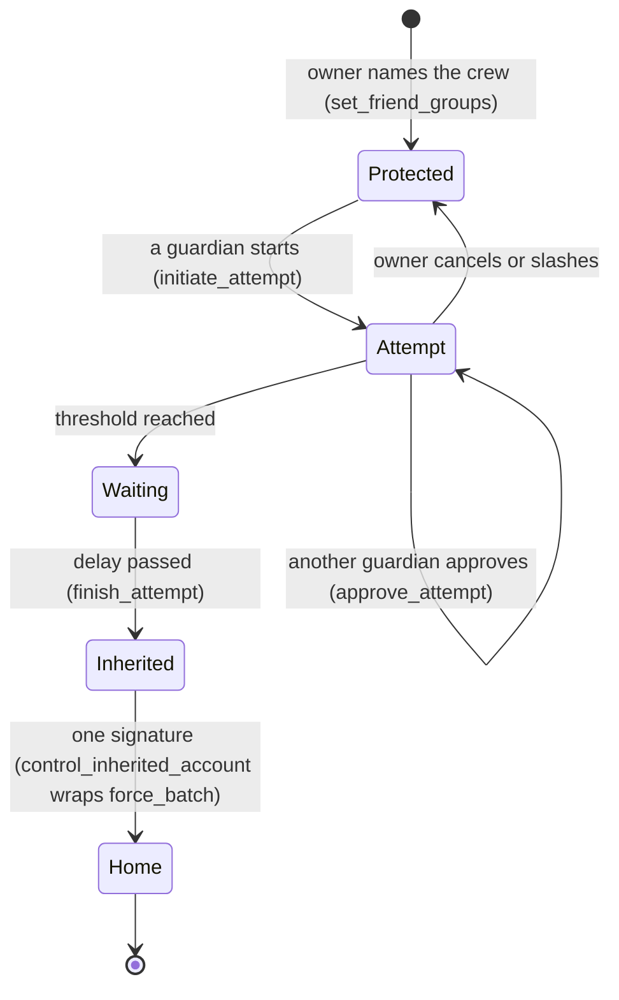
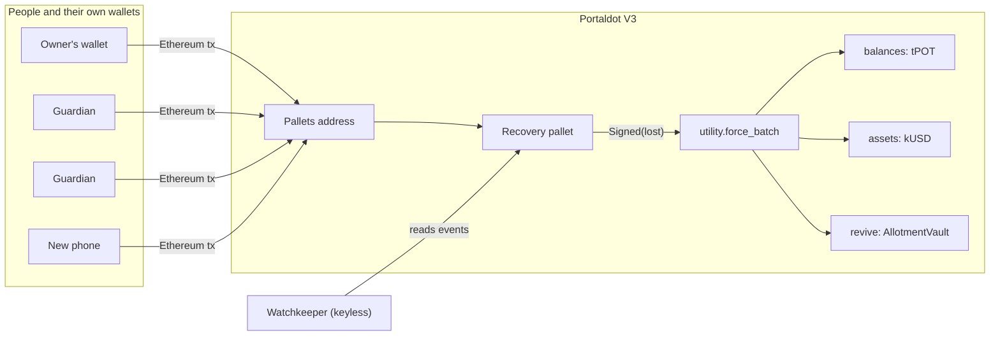

<p align="center"></p>

<h1 align="center">Kedge</h1>

<p align="center"><b>A wallet your crew can bring back, and no single person can take.</b></p>

<p align="center">
  
  
  
  
</p>

> When a seafarer's phone goes overboard, Kedge lets his crew and family bring his wallet back, using Portaldot's built-in Recovery pallet, signed from the MetaMask he already has.

At 03:40 off Singapore, Ramon's phone slips over the side. His wages were on it. On most EVM chains that wallet is gone for good. On Portaldot V3 it is not: every MetaMask address has a native twin account, the twin can use the chain's own **Recovery pallet**, and a rescuer can then run a Solidity contract call **as the lost address**. Kedge turns that into a product a deckhand can use: name a crew once, keep a wallet-size card, and if the phone is lost, two people you trust approve, the chain makes everyone wait, and one signature brings it all home.

| | |
|---|---|
| **Live app** | **https://kedge-kinnoskis-projects.vercel.app** (Vercel, no login). The 12-step wallet journey below passed against this URL |
| **See it work in 2 minutes** | `/drill`: a full rescue on the live testnet, streamed step by step |
| **Check our claims** | `npm run verify` re-reads 31 recorded transactions from the public node with no key. `/proof` decodes them in your browser |
| **Measured** | 2 of 2 rescues completed, 8 of 8 attacks stopped, **0** honest rescues wrongly blocked, 0.063 tPOT in fees per rescue |
| **Built on** | Portaldot V3: Recovery, Utility, Assets with the ERC-20 precompile, Revive, the pallets address |
| **Track** | Ecosystem DApps |
| **Pitch deck** | [docs/kedge-deck.pdf](docs/kedge-deck.pdf) |

<table>
<tr><td width="50%"><br /><sub><b>Harbour.</b> The owner names a crew, makes a passphrase-locked key for a new phone, and sees the cost before signing.</sub></td>
<td width="50%"><br /><sub><b>Crew door.</b> A guardian hears four words on a call and types them. Approve stays locked until they match.</sub></td></tr>
<tr><td><br /><sub><b>Rescue.</b> Timeline, delay clock in blocks, and a dry-run of every item: will move, or will not move and why.</sub></td>
<td><br /><sub><b>Proof.</b> Every recorded transaction, decoded in your browser from the public node.</sub></td></tr>
</table>

## Why this is different

| Approach | Who can move the money | What it costs the user | Weak point |
|---|---|---|---|
| Seed phrase on paper | anyone who finds it | nothing | lost paper means lost wallet; found paper means stolen wallet |
| Company-held seed backup | the company, a court order, a breach | a subscription and an identity check | custody by another name, and it needs a signal and a camera |
| Smart-contract wallet with guardians | guardians, through a contract | a new wallet and a migration | you must change wallets **before** the loss, and each chain needs its own |
| Exchange custody | the exchange | fees and KYC | one founder, one server: a single point of failure |
| **Kedge on Portaldot** | **two of your guardians, after a delay you set, and you can still cancel** | **0.027 tPOT to protect, 0.063 tPOT to rescue, no deposit** | no new wallet; the Recovery pallet is the chain's own, and the rescue even reaches money held in Solidity contracts |

What nobody else here does is the last part. A rescue that only moved native coins would leave a seafarer's savings stranded in contracts. Kedge's sweep also pays out a Solidity vault that only the old address could withdraw from, because the chain lets the rescuer call it **as** that address.

## The rescue, step by step



1. **Name the crew.** From MetaMask, the owner picks guardians, how many must agree, the safety delay, and the wallet on a new phone. This costs only a fee: V3 holds no deposit for it.
2. **Keep a card.** A wallet-size PDF holds the new key, locked with a passphrase only the owner knows. Alone it cannot move a cent.
3. **Call, hear, type.** After a loss, a guardian phones the owner. The new phone shows four words derived from (lost wallet, new wallet, group, chain). The guardian types them; **approve stays disabled until they match**. A scam link that names a different new wallet produces different words.
4. **Wait.** Two approvals start the delay. The owner gets one alert per attempt, and while he still holds his phone he can stop it, or slash the starter.
5. **Bring it home.** The new phone finishes the attempt and signs once. A single `force_batch` pays out the vault, moves the native asset, then sweeps the coin. If one item fails, the rest still move and the receipt shows exactly which.

## What we found on Portaldot V3 (measured, not claimed)

These came from probes on the live testnet before we built anything, and are written up with hashes in [PLATFORM_PROBE.md](PLATFORM_PROBE.md) and [docs/FINDINGS.md](docs/FINDINGS.md).

- **A MetaMask address can drive the Recovery pallet.** An Ethereum transaction to the runtime pallets address `0x6d6f...0000` is dispatched as a native call from the sender's twin account. Owner, guardians and inheritor completed the whole lifecycle with plain Ethereum transactions.
- **`msg.sender` is the lost address.** Inside `control_inherited_account`, a `revive.call` runs the contract with the old address as the caller. That is the whole trick behind the vault payout (probe part 7, block 317779).
- **A contract cannot be the rescuer.** A Solidity contract calling the pallets address does nothing: it returns success with no effect. So Kedge refuses a contract as the inheritor, and the refusal is backed by a probe, not a guess.
- **Receipts lie in two different ways.** A refused Recovery call is an *extrinsic success* plus `revive.EthExtrinsicRevert` with receipt status 0. A failed inner call inside `control_inherited_account` leaves receipt status **1** and only shows up in `RecoveredAccountControlled.call_result`. Kedge's Helmsman never trusts the receipt: it matches the extrinsic by `keccak256(payload) == eth tx hash` (9 of 9 hashes) and reads the events.
- **The vault gives its deposit back.** The sweep returned 3.799 tPOT of contract storage deposit, because withdrawing zeroes the slot.
- **This testnet's security deposit is 0.** Slashing a bad attempt burns nothing, so the real deterrent is two guardians, the delay, and the owner's cancel. We say so in the UI.

## Safety model

| Who | What they can try | What stops them | Proof |
|---|---|---|---|
| A stranger | start an attempt on your wallet | `NotFriend` | A1 |
| One guardian alone | finish with one approval | `NotApproved` | A2 |
| A guardian in a hurry | finish before the delay | `NotYetInheritable` | A3 |
| A guardian voting twice | stack approvals | `AlreadyApproved` | A4 |
| A bad initiator | cancel to dodge a slash | `NotYetCancelable` | A6 |
| A rescuer | rewrite the crew through the inheritance | the call is filtered: `call_result = Err` | A7 |
| A lower-priority group | take over after the family group recovered | `HigherPriorityRecovered` | A9 |
| A scam link | show a different new wallet | the four words differ, approve stays locked | A12 |
| A bad sweep item | block the rest | `force_batch`: that item fails, the others move | A10 |
| Nobody at all (no Kedge) | move a wallet whose key is gone | no path exists | C1, C2 |

The four-word phrase is **advisory UI**: it helps a human catch a scam. The chain enforces the approval count and the delay.

## Measured

Both directions are reported, **and the second number is the one that matters.** Money figures are rounded here; exact values are in `docs/FACTS.json`.

| | |
|---|---|
| Rescues completed / attempted | 2 of 2 (one with a guardian on a native sr25519 wallet) |
| Attacks stopped | 8 of 8: 6 refused on chain with a decoded error (A1, A2, A3, A4, A6, A9) and 2 stopped by pre-flight guards (A11, A12) |
| All scenarios | 16 of 16 as expected: 2 on-chain happy paths, 6 on-chain refusals, 4 on-chain behaviours (A5, A7, A8, A10), 2 guard refusals, 2 counterfactuals |
| Honest rescues wrongly blocked | 0 |
| Cost to protect | 0.027 tPOT fee, 0 deposit |
| Cost per rescue | 0.063 tPOT in fees |
| Safety delay | 10 blocks, measured 55 s |
| Browser end-to-end | 12 of 12 end-to-end steps passed in headless Chromium (details below) |
| Public drills | 2 live runs, recorded in `docs/drills/`; a second request during a run is refused (HTTP 409) |

| Id | Scenario | Result | Observed | Proof |
|---|---|---|---|---|
| H1 | Happy path: setup, initiate, approve, wait, finish, bring home (tPOT + kUSD + vault) | pass | `Ok` | [317396](https://scanner-testnet-v3.portaldot.dev/#/blocks/317396?tab=events) |
| H2 | Cross-VM guardians: one sr25519 guardian approves with a native extrinsic, two on MetaMask | pass | `Ok` | [317418](https://scanner-testnet-v3.portaldot.dev/#/blocks/317418?tab=events) |
| A1 | A1 | pass | `recovery.NotFriend` | [317445](https://scanner-testnet-v3.portaldot.dev/#/blocks/317445?tab=events) |
| A2 | A2 | pass | `recovery.NotApproved` | [317447](https://scanner-testnet-v3.portaldot.dev/#/blocks/317447?tab=events) |
| A3 | A3 | pass | `recovery.NotYetInheritable` | [317450](https://scanner-testnet-v3.portaldot.dev/#/blocks/317450?tab=events) |
| A4 | A4 | pass | `recovery.AlreadyApproved` | [317449](https://scanner-testnet-v3.portaldot.dev/#/blocks/317449?tab=events) |
| A5 | A5 | pass |  | [317451](https://scanner-testnet-v3.portaldot.dev/#/blocks/317451?tab=events) |
| A6 | A6 | pass | `recovery.NotYetCancelable` | [317453](https://scanner-testnet-v3.portaldot.dev/#/blocks/317453?tab=events) |
| A7 | Reentrancy guard: inheritor tries to rewrite recovery config through control_inherited_account | pass | `{"Err":{"Module":{"index":"0","error":"0x05000000"}}}` | [317482](https://scanner-testnet-v3.portaldot.dev/#/blocks/317482?tab=events) |
| A8 | Priority override: Family (priority 0) finishes after Crew | pass |  | [317480](https://scanner-testnet-v3.portaldot.dev/#/blocks/317480?tab=events) |
| A9 | Priority lock: Crew tries again after Family recovered | pass | `recovery.HigherPriorityRecovered` | [317481](https://scanner-testnet-v3.portaldot.dev/#/blocks/317481?tab=events) |
| A10 | Sweep with one item that must fail | pass | `Ok` | [317483](https://scanner-testnet-v3.portaldot.dev/#/blocks/317483?tab=events) |
| A11 | Contract set as inheritor | pass |  | guard |
| A12 | Scam link with a different inheritor | pass |  | guard |
| C1 | Counterfactual: a wallet without Kedge, key discarded | pass |  | guard |
| C2 | Counterfactual: EVM-only vault position without Kedge | pass |  | [317489](https://scanner-testnet-v3.portaldot.dev/#/blocks/317489?tab=events) |

**Where we were wrong, in public.** We predicted `AlreadyVoted` for a double approval; the chain says `AlreadyApproved` (A4). Our first campaign run read refused calls as successes until we found the `EthExtrinsicRevert` shape. A5 burned nothing because the deposit is zero. Each is in [docs/FINDINGS.md](docs/FINDINGS.md).

## The browser test: real signing, real chain

`e2e/wallet.mjs` drives headless Chromium through every screen. An EIP-1193 provider is injected into the page and backed by a real key in the test process, so each transaction is **signed and sent to the live testnet**: connect, switch chain, sign a message for alerts, protect a wallet, read the phrase on the new phone, lock and unlock the guardian gate, approve, wait out the delay, bring it home, stop and slash from the alert link, decode a refused attack on `/proof`, run the tour, run a drill, and a 390 px phone pass. Run against the live Vercel URL; videos and screenshots are in `docs/demo/deployed-run/` (and the first local run in `docs/demo/test-run/`).

- pass: A1 connect deployer wallet and subscribe to alerts (EIP-191 signature)
- pass: B1 Lifeboat key made in the browser and the card PDF downloads
- pass: C1 owner protects a wallet from Harbour (set_friend_groups through the wallet)
- pass: C2 new phone shows the four-word call phrase
- pass: D1 guardian Lorna: locked on a wrong phrase, unlocks on the right one, starts the attempt
- pass: D2 guardian Ben: same gate, approves
- pass: E1 safety delay passes and the new phone brings everything home in one signature
- pass: F1 owner stops an attempt he did not start (alert link), then slashes a second one
- pass: G1 Proof page decodes a refused attack (A3) in the browser from the public node
- pass: G2 guided tour runs through all 7 steps with the keyboard
- pass: G3 Muster Drill runs a full rescue from the page
- pass: H1 mobile (390 px): connect and protect form usable, no horizontal scroll

This is an injected test wallet, **not** the Rabby or SubWallet extension. It proves the app's wallet paths against real signatures; a session with the physical extensions is still open (see *Limits*).

## Architecture



| Module | One job | Can it sign? |
|---|---|---|
| Purser `purser.ts` | builds every call from live metadata | no |
| Helmsman `helm.ts` | sends the wallet transaction, persists the hash first, resolves the real outcome from events | the user's wallet only |
| Lookout `lookout.ts` | reads crews, attempts, delay clocks | no |
| Surveyor `survey.ts` | inventories the old wallet and dry-runs every sweep item | no |
| Mate `mate.ts` | pre-flight refusals (contract inheritor, sorting, thresholds, delay) | no |
| Watchkeeper `watch/` | detects attempts, alerts the owner | no, keyless by construction |
| Logkeeper `scripts/facts.mjs` | writes the numbers on this page from receipts | no |

No model sits anywhere in the money path. A dependency-free SCALE encoder (`watch/scale.mjs`) is tested **byte for byte** against polkadot.js on live metadata.

## What it will not do

| Refusal | Where | Backed by |
|---|---|---|
| Name a contract as the inheritor | `mate.ts` | probe part 8 |
| List guardians unsorted or twice | `mate.ts`, `purser.ts` | chain `FriendsNotSortedOrUnique`, even with our check disabled (`KEDGE_SABOTAGE=sort`, block 317530) |
| Rescue before the delay | `mate.ts` | A3 |
| Approve without the phrase | Crew door | A12 (advisory) |
| Move an item that would fail | `survey.ts` | A10 |
| Run a drill when the kill switch is on or keys are missing | `/api/drill` | HTTP 503 with a plain message |

## Run it yourself

```bash
git clone https://github.com/0xkinno/kedge && cd kedge
npm ci
npm run verify        # keyless: re-reads every recorded transaction from the public node
npm test              # unit, encoder and live-chain tests
(cd contracts && forge test)
cd apps/web && npm ci && npx next build && npx next start -p 3100
BASE=http://localhost:3100 node ../../e2e/wallet.mjs     # full wallet journey, signs on testnet
```

Deploy: `VERCEL_TOKEN=... bash scripts/deploy_vercel.sh` creates the project, sets the root directory and env vars, deploys, and tests the live link. Env (server only): `DRILL_RAMON_PK`, `DRILL_LORNA_PK`, `DRILL_BEN_PK`, `DRILL_LIFEBOAT_PK` (testnet-only), `UPSTASH_REDIS_REST_URL`, `UPSTASH_REDIS_REST_TOKEN`, `TELEGRAM_BOT_TOKEN`, `DRILL_KILL`. `scripts/keygen.mjs` writes keys to the gitignored `keys/`.

## Where the numbers come from

Nothing headline is typed. `scripts/facts.mjs` builds [docs/FACTS.json](docs/FACTS.json) from receipts; the landing page, this README, the deck and the docs read it, and tests fail on drift. Market figures are in [docs/sources.json](docs/sources.json) with exact quotes that `npm run verify:sources` re-checks against the live pages:

| Fact | Source |
|---|---|
| About 1.89 million seafarers serve the world merchant fleet (2021 report, through press coverage) | [World shipping faces looming officer shortage](https://www.marinelog.com/news/world-shipping-faces-looming-officer-shortage/) |
| Sea-based Filipino workers sent home $7.139 billion in 2025. | [OFW remittances hit record $35.6B](https://bworldonline.com/top-stories/2026/02/17/730931/ofw-remittances-hit-record-35-6b/) |
| About 3.7 million bitcoin, around 20 percent of supply, had not moved for five years (June 2020). Dormant, not proven lost | [Lost Bitcoin: 3.7 million Bitcoin are probably gone forever](https://decrypt.co/37171/lost-bitcoin-3-7-million-bitcoin-are-probably-gone-forever) |
| A hardware-wallet vendor's seed backup service split the phrase among three custodians and drew backlash (2023) | [So Much Anger, So Much Hate, Says Ledger Co-Founder Amid Botched Recover Service Launch](https://decrypt.co/140692/so-much-anger-so-much-hate-says-ledger-co-founder-amid-botched-recover-service-launch) |
| An exchange founder died and about 190 million Canadian dollars of customer crypto became inaccessible (2019) | [Customers Out $190M After Founder Dies, Cryptocurrency Exchange Says](https://www.vice.com/en/article/customers-out-dollar190m-after-founder-dies-cryptocurrency-exchange-says/) |
| The Philippines ranks 9th and Nigeria 6th in the 2025 crypto adoption index | [The 2025 Global Adoption Index: India and the United States Lead Cryptocurrency Adoption](https://www.chainalysis.com/blog/2025-global-crypto-adoption-index/) |

## Business and what comes next

Free for individuals. Manning agencies and seafarer welfare groups reach crews at scale; wallet makers can embed the protection flow because every Portaldot account is recoverable the same way, and families use the same mechanism with a longer delay for inheritance. Next: a real-people drill with consenting guardians, deploying the ink! vault so one rescue spans both contract VMs, the real Rabby and SubWallet sessions, and an agency pilot.

## Limits, stated plainly

- The ink! (WASM) contract is written and unit-tested (`ink/allotment_ink`) but **not deployed**: this chain charges 0.06 tPOT per byte of contract code, so its 4.9 KB would need about 295 tPOT. Until it is deployed, the "WASM" half of WASM/EVM is **not** demonstrated.
- The security deposit is 0 on this testnet, so slashing is a signal, not a penalty.
- The demo token is Kedge's own **kUSD** (asset 20261104). The pUSD pool held about 127 pUSD, too thin to demo with.
- Wallet paths are proven with an injected test wallet backed by real signing, not yet with the Rabby or SubWallet extensions, and not on MetaMask mobile.
- No real-people drill has been run yet.
- Testnet only. Not audited.

## Docs

[EVIDENCE](EVIDENCE.md) · [PROOF](PROOF.md) · [FINDINGS](docs/FINDINGS.md) · [PLATFORM_PROBE](PLATFORM_PROBE.md) · [DISCOVERY](DISCOVERY.md) · [SDK_SURFACE](SDK_SURFACE.md) · [RISK](RISK.md) · [THESIS](THESIS.md) · [MOMENT](MOMENT.md) · [DESIGN](DESIGN.md) · [JUDGE](JUDGE.md) · [PROGRESS](PROGRESS.md) · [MILESTONES](MILESTONES.md) · [REDTEAM_LOG](REDTEAM_LOG.md)

## Disclosures

AI assistance: Claude Code drafted much of the code and docs under the author's direction and review. The hero image is AI-generated. Third-party: ethers, polkadot.js, Next.js, Foundry's forge-std, solc-js, the BIP39 English word list (the call phrase). Persona names and the pitch voice are illustrative.

## License

MIT
