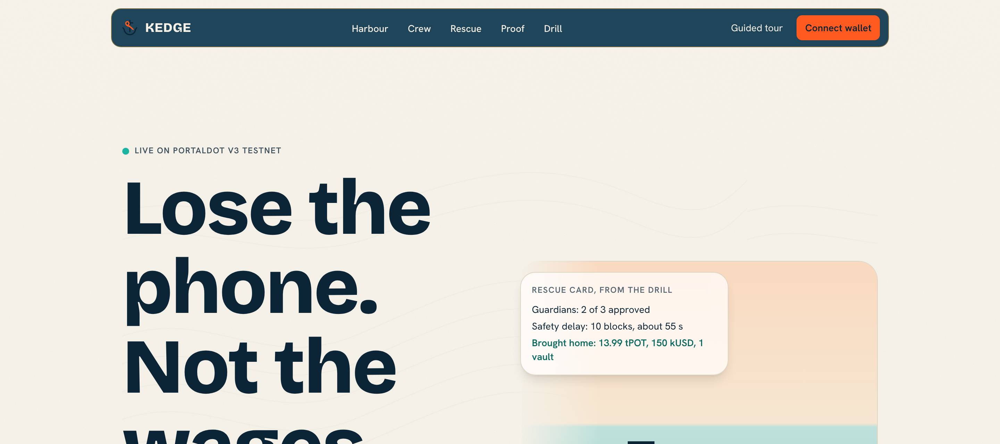
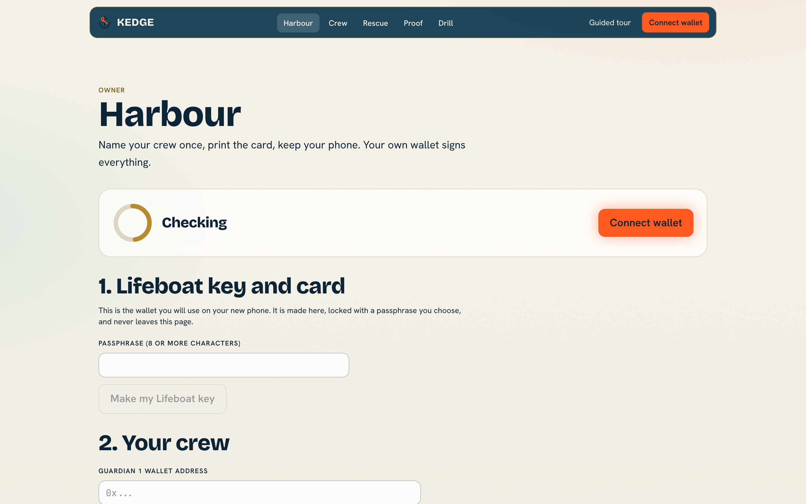
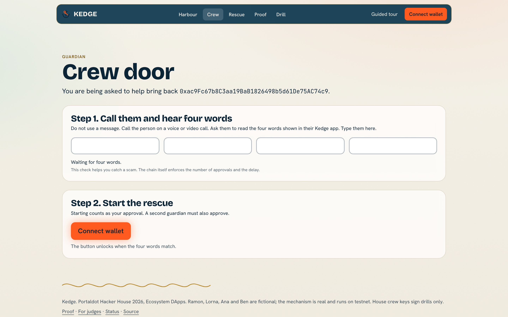
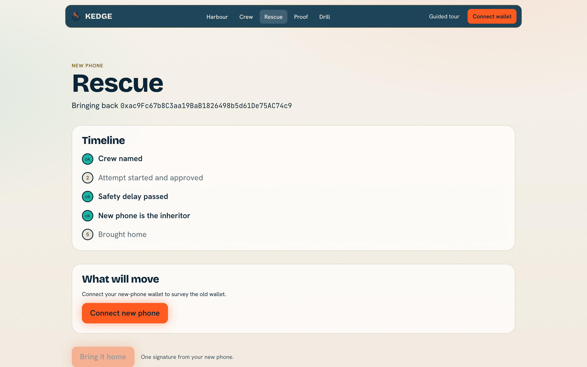
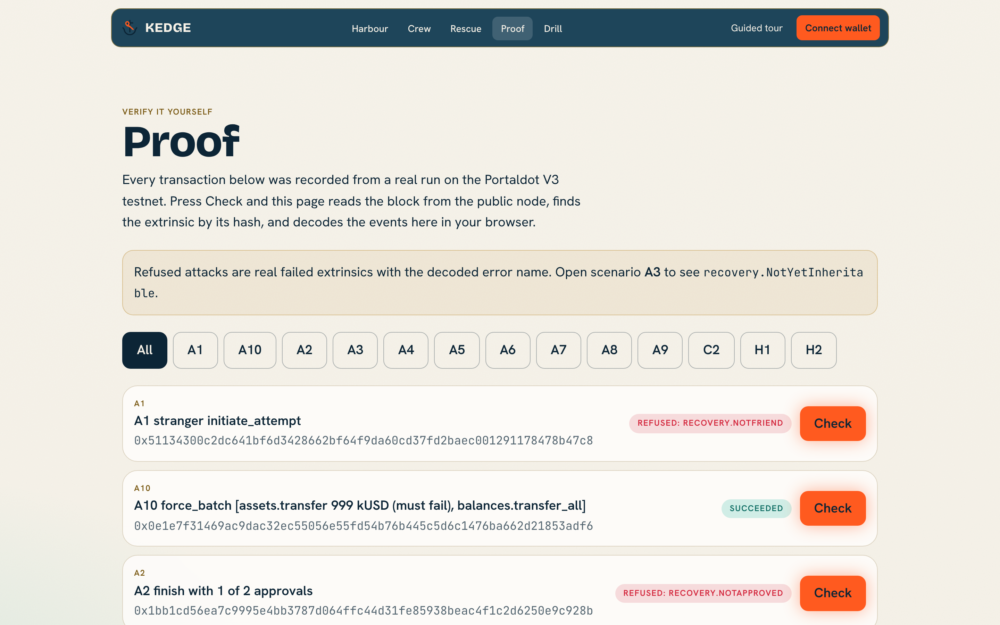
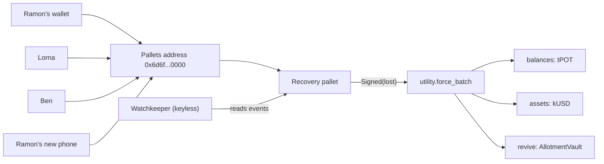
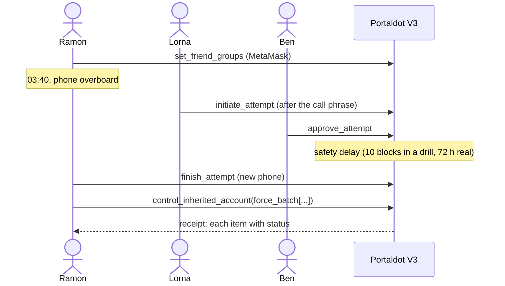

<p align="center"></p>

# Kedge

  

**When a seafarer's phone goes overboard, Kedge lets his crew and family bring his wallet back, using Portaldot's built-in Recovery pallet, signed from the MetaMask he already has.**

A wallet your crew can bring back, and no single person can take.

Ramon is a fictional able seaman. His phone goes over the side at 03:40 off Singapore. Two of his three guardians confirm on a call that it is really him and approve from their own wallets. After a safety delay his new phone brings home his tPOT, his test dollars and what his allotment contract holds, with one signature. All of it runs on the Portaldot V3 testnet today.

| | |
|---|---|
| Live app | **Not deployed yet.** Run it locally (below). The Vercel deploy needs the owner's account |
| For judges | `/judge` (60-second walk) |
| Run a rescue | `/drill` (about two minutes, testnet, house crew keys) |
| Verify it yourself | `/proof`, or `npm run verify` with no key |
| Demo video | a silent recording of the guided tour is in [docs/demo/tour-silent.webm](docs/demo/tour-silent.webm); the final video with live wallet clips is not recorded yet |
| Pitch deck | [docs/kedge-deck.pdf](docs/kedge-deck.pdf) |
| Track | Ecosystem DApps |
| Built on | Portaldot V3: Recovery, Utility, Assets and the ERC-20 precompile, Revive, the pallets address |
| Measured | 2 of 2 rescues completed, 9 of 9 attacks stopped, **0** legitimate rescues wrongly blocked, 0.06293 tPOT in fees per rescue |

| Harbour | Crew door |
|---|---|
|  |  |
| **Rescue** | **Proof** |
|  |  |

## The problem

Ramon is seven months into a nine-month contract on a bulk carrier. His wages sit in a wallet on his phone. His seed phrase is on a scrap of paper in a drawer in Iloilo, or nowhere. A seed-phrase wallet has no "forgot password", custodial apps want identity checks from a ship with no signal, and a company-run seed backup means handing his keys to a company. Ramon, Lorna, Ana and Ben are fictional and labelled so on every screen.

| What is true | Source |
|---|---|
| About 1.89 million seafarers serve the world merchant fleet (2021 report, through press coverage) | [World shipping faces looming officer shortage](https://www.marinelog.com/news/world-shipping-faces-looming-officer-shortage/) |
| Sea-based Filipino workers sent home $7.139 billion in 2025. | [OFW remittances hit record $35.6B](https://bworldonline.com/top-stories/2026/02/17/730931/ofw-remittances-hit-record-35-6b/) |
| About 3.7 million bitcoin, around 20 percent of supply, had not moved for five years (June 2020). Dormant, not proven lost | [Lost Bitcoin: 3.7 million Bitcoin are probably gone forever](https://decrypt.co/37171/lost-bitcoin-3-7-million-bitcoin-are-probably-gone-forever) |
| A hardware-wallet vendor's seed backup service split the phrase among three custodians and drew backlash (2023) | [So Much Anger, So Much Hate, Says Ledger Co-Founder Amid Botched Recover Service Launch](https://decrypt.co/140692/so-much-anger-so-much-hate-says-ledger-co-founder-amid-botched-recover-service-launch) |
| An exchange founder died and about 190 million Canadian dollars of customer crypto became inaccessible (2019) | [Customers Out $190M After Founder Dies, Cryptocurrency Exchange Says](https://www.vice.com/en/article/customers-out-dollar190m-after-founder-dies-cryptocurrency-exchange-says/) |
| The Philippines ranks 9th and Nigeria 6th in the 2025 crypto adoption index | [The 2025 Global Adoption Index: India and the United States Lead Cryptocurrency Adoption](https://www.chainalysis.com/blog/2025-global-crypto-adoption-index/) |

Exact quotes, dates and caveats are in [docs/sources.json](docs/sources.json); `npm run verify:sources` re-checks them against the live pages.

## The solution

1. Ramon names his crew once, from MetaMask: two of three guardians, a safety delay, and the wallet on his new phone.
2. He prints a wallet-size **Lifeboat Card**. It holds his new key locked with a passphrase only he knows. It cannot move a cent.
3. After the loss, a guardian calls him, hears four words read from his new phone, types them, and starts the attempt. The approve button stays locked until the words match.
4. A second guardian approves. The chain makes everyone wait out the safety delay. Ramon gets one alert per attempt and can stop or punish any attempt he did not start.
5. His new phone finishes the attempt and brings everything home in one signature. A receipt shows each item and its status.

What always gets through: an attempt Ramon did not start reaches him, and he can cancel it while he holds his phone.

## Explore it in 2 minutes

1. Open `/drill` and press Start. Watch a full rescue run on testnet.
2. Wait out the live block countdown, then open the receipt and each explorer link.
3. Open `/proof`, filter to A3, press Check. The page reads the block from the public node and decodes `recovery.NotYetInheritable` in your browser.
4. Open C1: the counterfactual account that nobody can move.

## Architecture



```
 Ramon's MetaMask   Lorna    Ben    Ramon's new phone
        |             |       |            |
        v             v       v            v
   Ethereum tx to the Portaldot pallets address (0x6d6f...0000)
 set_friend_groups  initiate approve   finish + control_inherited_account
        '-------------+-------+-------------'
                      v
              Recovery pallet (native)
                      | Signed(Ramon's old account)
                      v
            utility.force_batch([ ... ])
      balances: tPOT | assets: kUSD | revive.call: AllotmentVault (msg.sender = old address)
```

## Product flow



## Why this needs Portaldot

Every MetaMask address has a native twin account (`h160` followed by twelve `0xEE` bytes, verified against the chain). An Ethereum transaction to the runtime pallets address is dispatched as a native call signed by that twin, so a plain MetaMask address can use the Recovery pallet. When the inheritor runs `revive.call` inside `control_inherited_account`, a Solidity contract sees the **old address** as `msg.sender`, so the vault pays the savings out. Native assets are reached from Solidity through the ERC-20 precompile. Delete Portaldot and step 5 fails. Details: [DISCOVERY.md](DISCOVERY.md), [PLATFORM_PROBE.md](PLATFORM_PROBE.md).

## What it will not do

| Refusal | Where | What backs it |
|---|---|---|
| Contract as inheritor | `apps/web/lib/kedge/mate.ts` | probe part 8: a contract calling the pallets address does nothing |
| Guardians not sorted or duplicated | `mate.ts`, `purser.ts` | chain error `FriendsNotSortedOrUnique` (fault switch proof, block 317530) |
| Rescue before the delay | `mate.ts` | chain error `NotYetInheritable` (A3) |
| Approve without the call phrase | `apps/web/lib/kedge/phrase.ts` and the Crew page | advisory UI (A12). The chain enforces threshold and delay |
| A stranger starting an attempt | chain | `NotFriend` (A1) |
| A sweep item that would fail | `survey.ts` | shown as "Will not move"; `force_batch` carries on (A10) |

## Portaldot specifically

See [SDK_SURFACE.md](SDK_SURFACE.md) for the full table with file and line, and the "not used, so not claimed" list. In short: no ink! contract, so the WASM half is not demonstrated.

## Measured

Both directions are reported. **The second number is the one that matters.**

| | |
|---|---|
| Rescues completed / attempted (curated campaign) | 2 of 2 |
| Attacks stopped | 9 of 9 |
| Legitimate rescues wrongly blocked | 0 |
| Cost to protect | 0.02700572815675 tPOT fee, deposits 0 |
| Cost per rescue | 0.06293 tPOT in fees |
| Contract storage deposit refunded in the sweep | 3.79868674820199 tPOT |
| Real-people drill | **not yet run** (needs 2 to 3 consenting guardians) |

| Id | Scenario | Result | Observed | Proof |
|---|---|---|---|---|
| H1 | Happy path: setup, initiate, approve, wait, finish, bring home (tPOT + kUSD + vault) | pass | `Ok` | [317396](https://scanner-testnet-v3.portaldot.dev/#/blocks/317396?tab=events) |
| H2 | Cross-VM guardians: one sr25519 guardian approves with a native extrinsic, two on MetaMask | pass | `Ok` | [317418](https://scanner-testnet-v3.portaldot.dev/#/blocks/317418?tab=events) |
| A1 | A1 | pass | `recovery.NotFriend` | [317445](https://scanner-testnet-v3.portaldot.dev/#/blocks/317445?tab=events) |
| A2 | A2 | pass | `recovery.NotApproved` | [317447](https://scanner-testnet-v3.portaldot.dev/#/blocks/317447?tab=events) |
| A3 | A3 | pass | `recovery.NotYetInheritable` | [317450](https://scanner-testnet-v3.portaldot.dev/#/blocks/317450?tab=events) |
| A4 | A4 | pass | `recovery.AlreadyApproved` | [317449](https://scanner-testnet-v3.portaldot.dev/#/blocks/317449?tab=events) |
| A5 | A5 | pass |  | [317451](https://scanner-testnet-v3.portaldot.dev/#/blocks/317451?tab=events) |
| A6 | A6 | pass | `recovery.NotYetCancelable` | [317453](https://scanner-testnet-v3.portaldot.dev/#/blocks/317453?tab=events) |
| A7 | Reentrancy guard: inheritor tries to rewrite recovery config through control_inherited_account | pass | `{"Err":{"Module":{"index":"0","error":"0x05000000"}}}` | [317482](https://scanner-testnet-v3.portaldot.dev/#/blocks/317482?tab=events) |
| A8 | Priority override: Family (priority 0) finishes after Crew | pass |  | [317480](https://scanner-testnet-v3.portaldot.dev/#/blocks/317480?tab=events) |
| A9 | Priority lock: Crew tries again after Family recovered | pass | `recovery.HigherPriorityRecovered` | [317481](https://scanner-testnet-v3.portaldot.dev/#/blocks/317481?tab=events) |
| A10 | Sweep with one item that must fail | pass | `Ok` | [317483](https://scanner-testnet-v3.portaldot.dev/#/blocks/317483?tab=events) |
| A11 | Contract set as inheritor | pass |  | guard |
| A12 | Scam link with a different inheritor | pass |  | guard |
| C1 | Counterfactual: a wallet without Kedge, key discarded | pass |  | guard |
| C2 | Counterfactual: EVM-only vault position without Kedge | pass |  | [317489](https://scanner-testnet-v3.portaldot.dev/#/blocks/317489?tab=events) |

Misses and surprises: A4 returned `AlreadyApproved`, not the predicted `AlreadyVoted` (refusal held). A5 burned nothing because this testnet's security deposit is 0. Full list in [PROOF.md](PROOF.md) and [docs/FINDINGS.md](docs/FINDINGS.md). Two live drills through `/api/drill` are recorded in `docs/drills/`.

## Security model and limits

- **Trust:** the Kedge server holds no user key. The Watchkeeper is keyless by construction (a test greps for key material).
- **Deposits:** V3 sets the security deposit to 0 and friend groups take no deposit, so a bad initiator risks only fees. Two guardians and the delay are still required.
- **The call phrase is advisory UI.** The chain enforces the threshold and the delay.
- **House drill keys** sign drills only, are capped, and are labelled "house crew" on every screen.
- **Designed, not live:** the unattended Telegram alert run (needs a bot token and Upstash), real-wallet tests on MetaMask mobile, and the public deployment.
- **Testnet only.** Not audited.

## Testnet deployment

| | |
|---|---|
| AllotmentVault | `0x92cD058Cb7E4d69476bFc7Cbb7630C50f13B57D4`, deploy tx `0x5d20d9a0c4be0cda48c3602ca60e8246cf38f691c6f53373f87d982643118ce8`, block [317284](https://scanner-testnet-v3.portaldot.dev/#/blocks/317284?tab=events) |
| Token | native asset 20261104 (kUSD) via the ERC-20 precompile `0x013528f000000000000000000000000000010000` |
| Every scenario transaction | [EVIDENCE.md](EVIDENCE.md) (31 transactions) |

## Judging criteria map

| Criterion | Where to look |
|---|---|
| Technical Feasibility (30%): "deployed on Portaldot testnet with verifiable on-chain interactions" | `npm run verify`, EVIDENCE.md, `/proof`, the commit history |
| Innovation (30%): "effective use of Portaldot V3 features such as WASM/EVM compatibility, modular architecture" | DISCOVERY.md, SDK_SURFACE.md (EVM and native pallets in one rescue; ink! not used) |
| Ecosystem Contribution (20%) | docs/FINDINGS.md (first public measurements of Recovery on V3), `watch/scale.mjs` (open encoder), the Harbour protection flow any dApp can copy |
| Business Potential (20%) | THESIS.md, the landing page, the sourced market numbers |

## Run it yourself

```bash
git clone https://github.com/0xkinno/kedge && cd kedge
npm ci
npm run verify          # keyless: re-reads every recorded tx from the public node
npm test                # 23 tests including live checks
cd apps/web && npm ci && npx next build && npx next start -p 3100
```

Env (server only unless prefixed `NEXT_PUBLIC_`): `DRILL_RAMON_PK`, `DRILL_LORNA_PK`, `DRILL_BEN_PK`, `DRILL_LIFEBOAT_PK` (testnet-only), `UPSTASH_REDIS_REST_URL`, `UPSTASH_REDIS_REST_TOKEN`, `TELEGRAM_BOT_TOKEN`, `DRILL_KILL=0`. `scripts/keygen.mjs` writes keys to the gitignored `keys/`.

## Docs

[EVIDENCE](EVIDENCE.md) · [PROOF](PROOF.md) · [FINDINGS](docs/FINDINGS.md) · [PROGRESS](PROGRESS.md) · [MILESTONES](MILESTONES.md) · [TASK](TASK.md) · [DESIGN](DESIGN.md) · [SDK_SURFACE](SDK_SURFACE.md) · [RISK](RISK.md) · [JUDGE](JUDGE.md) · [THESIS](THESIS.md) · [MOMENT](MOMENT.md)

## Disclosures

AI assistance: Claude Code drafted much of the code and docs, reviewed and directed by the author. Third-party code: ethers, polkadot.js, Next.js, Foundry's forge-std, solc-js, the BIP39 English word list (used for the call phrase). The persona and the spoken pitch voice are synthetic. The hero is an illustration; a photograph is planned. The demo token is Kedge's own kUSD, not pUSD.

## License

MIT
